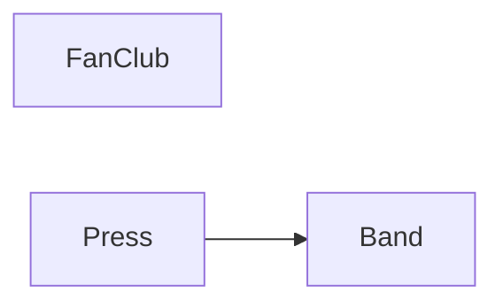

<!-- Generated by php artisan laravents:docs. Do not edit; run it again instead. -->

# Modules

| Module | Namespace | Commands | Queries | Events published | Events consumed | Depends on |
|---|---|---|---|---|---|---|
| [Band](Band.md) | `Modules\Band` | 2 | 1 | 2 | 0 | - |
| [FanClub](FanClub.md) | `Modules\FanClub` | 1 | 0 | 0 | 3 | - |
| [Press](Press.md) | `Modules\Press` | 1 | 0 | 0 | 1 | Band |

## Dependencies

