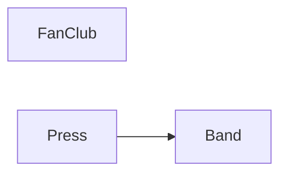

# Verification and Docs

## What `laravents:verify` checks

`php artisan laravents:verify` reads the source of every class, interface, trait and enum in `laravents.paths` and in `app/` (`app_path()`), builds the graph of references between modules, and checks four rules. It exits 1 on any violation, so it belongs in CI.

| Rule | A violation is | Example |
|---|---|---|
| Direction | a class outside a module, in another module or in no module at all, referencing it outside its `Api` | `Billing\Handlers\ChargeOnOrderPlaced uses Orders\Models\Order`, `App\Support\Receipts uses Orders\Models\Order` |
| Api purity | a class in a module's `Api` referencing its own module outside the `Api` | `Orders\Api\OrderPlaced uses Orders\Models\Order` |
| Cycles | modules that depend on each other in a cycle, through any reference | `Billing -> Orders -> Billing` |
| Registry | a discovery error: what would fail at boot or at `laravents:cache` | a duplicate routing key, `#[Authorize]` on an event handler |

Each violation names the class, what it uses, and the file and line of the first reference, relative to the base path. Every rule runs in one pass, so a run reports everything wrong at once: a direction violation and the cycle it closes are both reported.

The graph has an edge from A to B for every reference from A into B, inside B's Api or not, and cycles are checked over that graph: depending on a module through its Api is still depending on it. Each elementary cycle is reported once, starting at its alphabetically smallest module. `--allow-cycles` reports cycles as warnings and lets the command pass, for a codebase that is breaking a cycle up and wants the other rules enforced meanwhile.

Code outside every module (`app/`, or a directory added to `laravents.paths` such as a local package's) is held to the direction rule only: it may use a module's `Api`, never its handlers, models or services. It is not a module, so it adds no edge to the graph and takes part in no cycle. `app/` is read by `verify` alone, never by discovery at boot; to discover handlers there, add the directory to `laravents.paths`.

The registry is always built from a fresh scan, never from the `laravents:cache` file: verify is the check, not a consumer of the cache. The scan covers every module, those in `laravents.modules.disabled` too. Since `laravents:cache` scans the same paths with the same builder, a green verify followed by a successful cache means the cache holds a verified registry.

`--json` prints `{modules, graph, violations, passed}`, each violation `{rule, severity, message, class, uses, file, line}`, which maps one to one onto CI annotations. The [console page](console.md#laraventsverify) has the output.

Proven by `tests/Feature/Console/VerifyCommand.pest.php`.

## The scanner

The references come from `Laravents\Verify\DependencyScanner`, which reads each file with PHP's own tokenizer (`PhpToken::tokenize()`), no extra dependency. It resolves names as PHP resolves class names: fully qualified as written, `namespace\X` in the current namespace, otherwise by the first segment against the file's imports (case-insensitive), otherwise in the current namespace; each `namespace` statement resets the imports.

A resolved name is a reference when it names an existing class, interface, trait or enum (the scanner asks the autoloader, as `verify` already loads the classes it reads), unless PHP reads it as something else there:

- a member's name (after `->`, `?->`, `::`), or what is being declared (a class, function, enum case, constant, label);
- a function call (`name(`, except after `new` or opening an attribute), a named argument (`name:`), a method in a trait adaptation (`run as walk`);
- a built-in type, `self`, `static` or `parent`.

Imports (`use`, aliased, grouped, several per statement) are read whole; `use function` and `use const` import no class, and an imported namespace is an alias whose classes count where they are used. Functions and constants are never references, because no class has their name; a constant spelled exactly as a class of the same namespace would be the one exception.

## Blind spots

The scanner reads the source as written. It does not see:

- **Class names in strings.** `'Modules\Band\Models\Nickname'` is a string; `Nickname::class` is a reference.
- **Names built at run time.** `new $class`, `$class::find()`, `class_exists($class)`, `app($name)`, a class name read from config.
- **Docblock-only types.** `@param Nickname $nickname` and `@return Collection<int, Nickname>` are comments; a native type is a reference.

A dependency hidden in one of these is invisible to `verify`, as it is to any static check. Keep cross-module references native and typed, and they are checked.

Proven by `tests/Feature/Verify/DependencyScanner.pest.php`.

## The second check

The package's own test suite checks the same direction rule a second way, with the test runner's architecture expectations (Crucible's `arch()`, Pest's dialect), over the example modules:

```php
arch(sprintf('Modules\\%s uses Modules\\%s only through Modules\\%s\\Api', $user, $used, $used))
    ->expect('Modules\\'.$user)
    ->toOnlyUse(...[...$others, 'Modules\\'.$used.'\\Api', 'Laravents', 'Workbench']);
```

From [`tests/Architecture/Modules.pest.php`](../tests/Architecture/Modules.pest.php), one expectation per pair of modules. An application on Pest can keep the same test next to `laravents:verify`: two independent readers of the source, so a blind spot in one is not silently shared.

The two readers are also compared with each other. A cross-check test runs the scanner and Crucible's reference extraction over five fixture sets and asserts that they see exactly the same classes and the same references. Any disagreement fails the build, so neither reader can quietly drift.

Proven by `tests/Feature/Verify/CrucibleCrossCheck.pest.php` and `tests/Architecture/Modules.pest.php`.

## `laravents:show`

`php artisan laravents:show Band` prints one module's canvas: what it handles, what it publishes and to whom, what it consumes and from where, and which modules it depends on. Its Depends on section is the graph `verify` checks: per other module, the number of classes referencing it, and in red how many of those reach outside its Api. `--json` gives the same data. The [console page](console.md#laraventsshow) has the output.

## `laravents:docs`

`php artisan laravents:docs` writes a Markdown page per module and an index, from the same data `laravents:show` prints, into `laravents.docs.path` (`docs/laravents` by default) for a repository to commit and GitHub to render. The example application's pages are [docs/laravents/README.md](laravents/README.md), [Band](laravents/Band.md), [Press](laravents/Press.md) and [FanClub](laravents/FanClub.md).

The index has the module table and a Mermaid dependency graph:



From [`docs/laravents/README.md`](laravents/README.md). An edge that violates direction is dashed and labelled with the number of referencing classes outside the Api, `Billing -. "1 outside Api" .-> Orders`, with a one-line note under the graph. A module with no edges is a bare node.

Each module page has the sections Commands, Queries (routing key, handler, message, interceptors, HTTP), Events published (one row per listener), Events consumed (with the publishing module, `Laravel` for a framework event), Model publications, HTTP endpoints and Dependencies; an empty section says `None.` The first line of each file is an HTML comment saying it is generated.

The output depends only on the code: stable order, no timestamps, no counts that drift. A file whose content is unchanged is not rewritten, so `git status` stays clean and the file's modification time stays too. Pages of a module that no longer exists are left in place; delete them by hand.

`laravents:docs --check` builds the pages without writing and exits 1 when one is stale or missing, so CI catches a change that was not followed by `laravents:docs`.

Proven by `tests/Feature/Console/DocsCommand.pest.php`.
